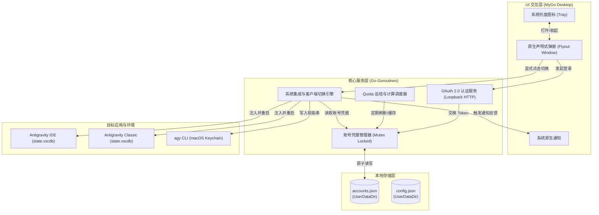

# Antigravities 产品与模块架构总览

Antigravities 是一个基于 Go 语言原生开发（`CGO_ENABLED=0`）的轻量级、高性能桌面应用，深度依托 **MyGo** 框架（`github.com/egoist/mygo`）提供的原生声明式 UI 和常驻系统托盘，专为 Antigravity 开发者提供多账号 OAuth 认证管理、模型配额监控以及一键无缝客户端凭据切换。

---

## 🏛 模块矩阵与职责划分

| 模块目录 | 核心职责 | 业务技术对齐 |
|---|---|---|
| [**account/**](account/README.md) | 账号数据模型、凭据持久化、`accounts.json` 原子写入与多进程读写锁 | 对应 `Antigravity-Manager/src-tauri/src/modules/account.rs` |
| [**oauth/**](oauth/README.md) | Google OAuth 2.0 PKCE 认证、本地回环服务器、Token 静默刷新调度器 | 对应 `Antigravity-Manager/src-tauri/src/modules/oauth.rs` |
| [**quota/**](quota/README.md) | 模型额度与速率限制（Rate-Limits）获取、分桶百分比解析、后台巡检机制 | 对应 `Antigravity-Manager/src-tauri/src/modules/quota.rs` |
| [**integration/**](integration/README.md) | 客户端进程探查、`state.vscdb` (SQLite) 注入、Protobuf 序列化、macOS Keychain 同步 | 对应 `Antigravity-Manager/src-tauri/src/modules/db.rs` 与 `integration.rs` |
| [**config/**](config/README.md) | 应用运行时参数、用户配置偏好（轮询周期、首选目标 IDE、主题外观） | 对应 `Antigravity-Manager/src-tauri/src/models/config.rs` |
| [**ui/**](ui/README.md) | MyGo 原生声明式界面、系统托盘管理、账号卡片、配额视图、[交互设计稿](ui/mockup.html) | 基于 `github.com/egoist/mygo/ui` 与原生 AppKit / Vibrancy |

---

## 🔄 全局系统交互与数据流向

---

## 📌 关键设计决策原则

1. **零 Cgo（Zero-CGO）原则**：所有网络、文件、系统调用与 SQLite 驱动均保证在 `CGO_ENABLED=0` 下正常编译与运行。
2. **显式切换（Explicit Switching）**：额度虽在后台巡检更新，但账号切换操作**绝不静默发生**，必须由用户在 UI/托盘中显式点击确认，防止编码过程意外中断。
3. **数据双向兼容**：存储的 JSON 字段严格对齐 `Antigravity-Manager`，便于用户在已有工具与 Antigravities 之间平滑过渡。
4. **macOS 优先体验**：原生窗口毛玻璃质感（Vibrancy）、系统钥匙串安全联动、标准菜单栏行为与免依赖单二进制分发。
