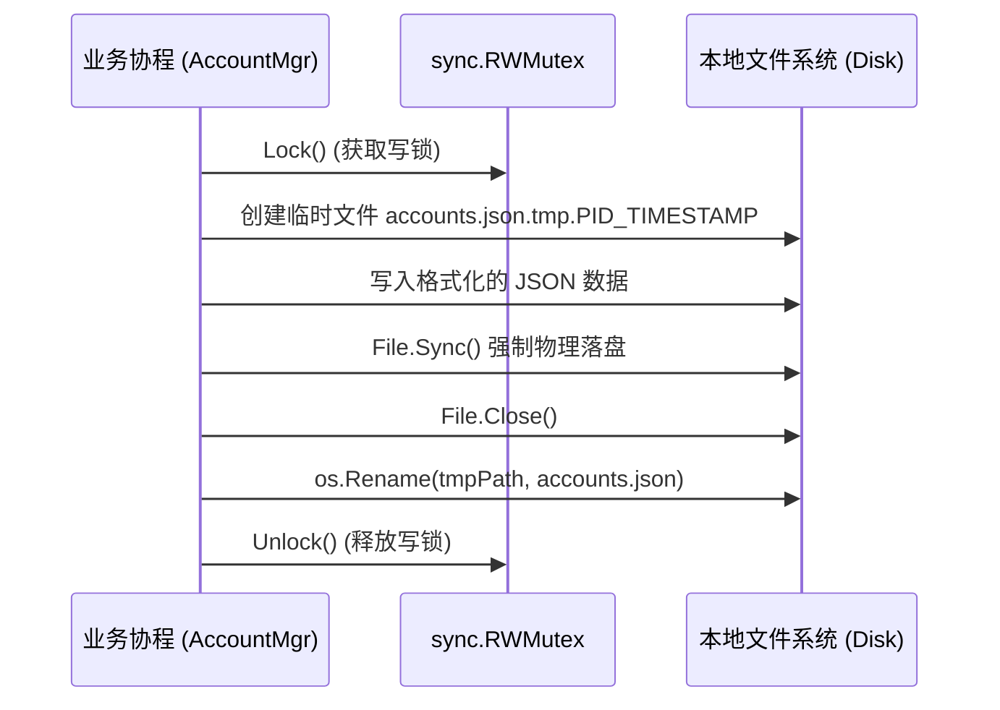

# 账号管理模块 (Account Module)

## 1. 模块功能

账号管理模块是 Antigravities 的核心数据管理中枢，负责在本地持久化并维护所有受纳管的 Antigravity 账号及其状态。具体功能包括：

- **账号生命周期维护**：支持添加账号、删除账号、更新凭据、标记当前生效（Active）账号。
- **凭据与元数据存储**：持久化 OAuth Token（Access Token、Refresh Token、到期时间戳）、用户信息（Email、头像 URL、展示名称）、模型配额快照及设备配置指纹（Device Profile）。
- **原子持久化保障**：写入磁盘时采用“先写临时文件 + 刷新落盘 (`sync`) + 原子重命名 (`rename`)”机制，杜绝断电或崩溃导致的数据截断与损坏。
- **并发安全读写**：采用进程级 `sync.RWMutex` 配合单账号排他锁，防止多协程（后台轮询、UI 操作、OAuth 回调）并发写入发生数据争用。
- **与 Antigravity-Manager 格式双向兼容**：数据结构与序列化规范保持 1:1 对齐，支持已有配置的平滑迁移与导入导出。

---

## 2. 实现逻辑与算法

### 2.1 存储位置与目录管理
- **文件路径**：`filepath.Join(mygo.App.UserDataDir(), "accounts.json")`
  - macOS 默认位置：`~/Library/Application Support/Antigravities/accounts.json`
  - Windows 默认位置：`%APPDATA%\Antigravities\accounts.json`
  - Linux 默认位置：`~/.config/antigravities/accounts.json`
- 初始化时，如果目录不存在，使用 `os.MkdirAll(dir, 0700)` 递归创建私有目录。

### 2.2 原子文件写流程 (`AtomicWriteFile`)


### 2.3 账号状态机与健康度流转
每个账号在运行期维护一个健康状态 `AccountStatus`：
- `StatusActive`：当前注入到客户端并处于活跃状态的账号。
- `StatusHealthy`：待命状态，Refresh Token 有效且配额充足。
- `StatusQuotaNearExhaustion`：主模型（如 Gemini 2.5 Pro）剩余额度 < 20%。
- `StatusQuotaExhausted`：模型额度已归零或处于 429 冷却期，等待重置。
- `StatusTokenInvalid`：Token 刷新失败（如 400 invalid_grant、用户撤销授权），需重新登录。

---

## 3. 详细设计 (Design)

### 3.1 核心数据结构定义

```go
package account

import (
	"sync"
	"time"
)

// Account 表示单个 Antigravity 账号实体
type Account struct {
	ID            string         `json:"id"`                      // UUID 唯一标识
	Email         string         `json:"email"`                   // 登录邮箱
	DisplayName   string         `json:"display_name,omitempty"`  // 用户展示昵称
	AvatarURL     string         `json:"avatar_url,omitempty"`    // 头像网络链接
	IsActive      bool           `json:"is_active"`               // 是否为当前客户端正在使用的账号
	Token         TokenData      `json:"token"`                   // OAuth 凭据信息
	Quota         *QuotaData     `json:"quota,omitempty"`         // 最新配额快照
	DeviceProfile *DeviceProfile `json:"device_profile,omitempty"`// 设备指纹（防风控关联）
	UpdatedAt     time.Time      `json:"updated_at"`              // 最后更新时间
	CreatedAt     time.Time      `json:"created_at"`              // 初始创建时间
}

// TokenData 描述 Google OAuth 凭据
type TokenData struct {
	AccessToken  string    `json:"access_token"`
	RefreshToken string    `json:"refresh_token"`
	ExpiresAt    time.Time `json:"expires_at"` // 绝对到期时间
	TokenType    string    `json:"token_type"`
}

// DeviceProfile 描述伪造/独立的客户端硬件指纹
type DeviceProfile struct {
	MachineID        string `json:"machine_id"`
	MacMachineID     string `json:"mac_machine_id"`
	ServiceMachineID string `json:"service_machine_id"`
	SqmID            string `json:"sqm_id"`
}

// AccountStore 账号管理器接口规范
type Store interface {
	ListAccounts() []*Account
	GetAccount(id string) (*Account, error)
	GetActiveAccount() *Account
	SaveAccount(acc *Account) error
	SetActive(id string) error
	DeleteAccount(id string) error
	UpdateToken(id string, token TokenData) error
	UpdateQuota(id string, quota *QuotaData) error
}
```

### 3.2 变更事件广播机制
当账号状态更新（切换生效账号、Token 自动刷新成功、配额更新）时，`AccountStore` 通过 Go 标准 channel 广播 `AccountChangeEvent`，UI 层监听此事件并通过 `mygo.App.OnMain()` 驱动界面自动重绘，无需频繁轮询文件。
