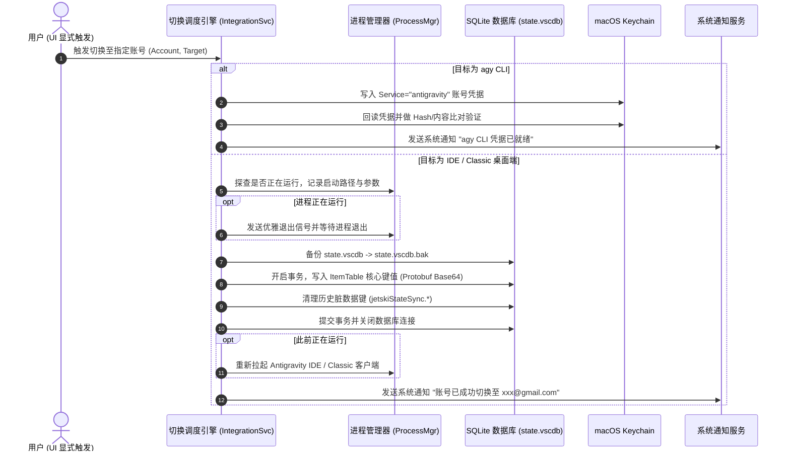

# 客户端集成与系统切换模块 (Integration Module)

## 1. 模块功能

客户端集成模块是 Antigravities 实现账号无缝切换的关键执行层，直接对接操作系统的外部环境，包括：

- **目标客户端环境智能探测**：支持识别 **Antigravity IDE**（VS Code 架构分支）、**Antigravity 经典桌面端** 及 **`agy` CLI 命令行工具**。
- **SQLite 凭据注入 (`state.vscdb`)**：使用纯 Go SQLite 驱动（`modernc.org/sqlite`，严格零 Cgo）安全修改编辑器的全局存储数据库。
- **Protobuf 状态序列化**：构建与 Antigravity 客户端底层完全一致的 Protobuf 二进制数据，并转换为 Base64 字符串写入数据库。
- **历史脏数据清理**：主动清理 `jetskiStateSync.agentManagerInitState` 等遗留状态键，消除历史 UserID 冲突导致的会话同步失败。
- **安全写前备份与回滚**：在执行 SQLite 写入前，必须生成 `state.vscdb.bak` 副本，若写入失败自动还原。
- **macOS Keychain 钥匙串同步**：针对 `agy` CLI，将最新 Token 安全写入 macOS Keychain 并执行严格的回读验证（Readback Verification）。
- **客户端进程平滑重启与通知**：探查正在运行的 IDE 进程，并在注入后执行安全退出、重启与系统级通知提示。

---

## 2. 实现逻辑与算法

### 2.1 切换执行全流程时序图



### 2.2 SQLite 注入键值规范 (`ItemTable`)
数据表结构为 VS Code 标准存储表：`ItemTable (key TEXT PRIMARY KEY, value TEXT)`。

| 写入 Key | 格式 / 内容 | 业务含义 |
|---|---|---|
| `antigravityUnifiedStateSync.oauthToken` | Base64 编码的 Protobuf Payload | 注入当前账号的 Access/Refresh Token 及授权凭据 |
| `antigravityUnifiedStateSync.userStatus` | Base64 编码的 Protobuf Payload | 用户身份状态与邮箱标记 |
| `antigravityOnboarding` | 字符串 `"true"` | 绕过客户端初次引导流程 |
| `antigravityUnifiedStateSync.enterprisePreferences` | Base64 编码（可选） | 关联的企业 GCP Project ID（如有） |
| `jetskiStateSync.agentManagerInitState` | **执行 DELETE 操作** | **必须删除**，防止客户端读取旧的 UserID 导致历史会话读取失败 |

### 2.3 Protobuf 纯 Go 轻量序列化
由于该结构相对固定，无需引入重量级的 `protoc` 生成流水线，采用纯 Go 轻量打包（Wire Format：Varint + Length-delimited string）：
1. 组装 `UnifiedStateEntry`（包含字段 key 与二进制 payload）。
2. 打包为 Varint 编码的 Protobuf 字节流。
3. 执行 `base64.StdEncoding.EncodeToString(...)`。

---

## 3. 详细设计 (Design)

### 3.1 核心接口定义

```go
package integration

import (
	"context"
	"antigravities/internal/account"
)

// TargetType 目标客户端类型
type TargetType string

const (
	TargetIDE     TargetType = "ide"     // Antigravity IDE
	TargetClassic TargetType = "classic" // Antigravity 经典桌面端
	TargetAgyCLI  TargetType = "agy"     // agy 命令行工具
)

type SwitchResult struct {
	Target       TargetType
	AccountEmail string
	NeedRestart  bool
	Restarted    bool
}

type Switcher interface {
	// DetectEnvironments 探测本机已安装与运行中的环境
	DetectEnvironments() ([]TargetType, TargetType, error)

	// SwitchAccount 执行目标账号的凭据注入与系统适配
	SwitchAccount(ctx context.Context, acc *account.Account, target TargetType) (*SwitchResult, error)

	// SyncAgyKeychain 针对 agy CLI 同步 macOS 钥匙串
	SyncAgyKeychain(acc *account.Account) error
}
```

### 3.2 进程安全与防御机制
- **写前校验**：如果 IDE 处于活动写锁状态，避免强行覆盖 SQLite 文件（防止数据库损坏）。
- **完整性回滚**：SQLite 写入过程置于 `BEGIN TRANSACTION` 与 `COMMIT` 中，若发生任何 SQL 报错，立即执行 `ROLLBACK` 并还原 `.bak` 备份文件。
