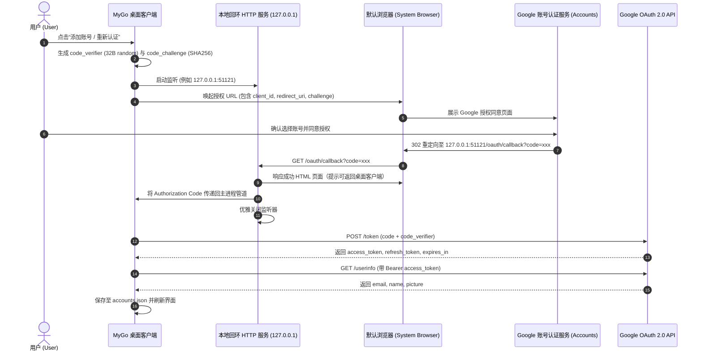

# OAuth 认证模块 (OAuth Module)

## 1. 模块功能

OAuth 认证模块负责完整的 Google OAuth 2.0 授权流程与 Token 生命周期管理，主要包括：

- **Google OAuth 2.0 PKCE 认证流程**：采用 RFC 7636 标准的 PKCE（Proof Key for Code Exchange）扩展，无需内嵌静态 Client Secret，保障桌面客户端身份安全性。
- **本地动态回环 HTTP 服务器**：在用户点击“添加账号”时启动临时的本地 HTTP 监听服务（默认尝试固定端口，若占用则回退至系统分配随机端口），捕获 Google 授权成功后重定向的 Authorization Code。
- **Token 交换与用户信息获取**：使用 Auth Code 与 Code Verifier 换取 `access_token`、`refresh_token` 以及 `id_token`，并调用 Google UserInfo API 拉取邮箱与头像。
- **Token 静默自动刷新调度器**：后台协程持续监控所有账号的凭据到期时间，在到期前 15 分钟（`TOKEN_REFRESH_SKEW_SECONDS = 900`）自动通过 Refresh Token 请求新凭据，确保持续生效。
- **异常捕获与状态标记**：对于 `invalid_grant`（用户取消授权或刷新令牌失效）进行状态标记，并提示用户重新登录。

---

## 2. 实现逻辑与流程

### 2.1 交互流程时序图



### 2.2 PKCE 核心生成逻辑
1. **Code Verifier**：生成 32 字节高熵随机数据，使用 URL-Safe 无填充 Base64 编码（长度在 43~128 字符之间）。
2. **Code Challenge**：
   $$\text{CodeChallenge} = \text{Base64URLEncode}(\text{SHA-256}(\text{CodeVerifier}))$$
3. **安全参数**：附带随机 `state` 参数，并在回环接收时严格比对，防御跨站请求伪造（CSRF）。

### 2.3 静默刷新调度算法
- 后台启动单例工作协程，每分钟扫描一次 `AccountStore` 中的活跃及健康账号。
- 判断条件：
  $$\text{time.Now().Add}(900 \times \text{time.Second}).\text{After}(\text{ExpiresAt})$$
- 触发刷新：若即将到期且持有 `refresh_token`，立即调用 Google Token 刷新端点更新内存与磁盘。

---

## 3. 详细设计 (Design)

### 3.1 常量与配置规范

```go
package oauth

import "time"

const (
	// 标准 Google OAuth Client 配置（推荐由环境变量或 -ldflags 构建期安全注入）
	DefaultClientID     = "YOUR_GOOGLE_CLIENT_ID.apps.googleusercontent.com"
	DefaultClientSecret = "YOUR_GOOGLE_CLIENT_SECRET"

	AuthEndpoint     = "https://accounts.google.com/o/oauth2/v2/auth"
	TokenEndpoint    = "https://oauth2.googleapis.com/token"
	UserInfoEndpoint = "https://www.googleapis.com/oauth2/v2/userinfo"

	// 提前 15 分钟触发刷新，预留网络波动与重试窗口
	TokenRefreshSkew = 15 * time.Minute

	// 回环服务器默认首选端口，被占用时随机选取端口
	DefaultLoopbackPort = 51121
	LoopbackTimeout     = 120 * time.Second
)

var OAuthScopes = []string{
	"https://www.googleapis.com/auth/userinfo.email",
	"https://www.googleapis.com/auth/userinfo.profile",
	"openid",
}
```

### 3.2 模块核心接口定义

```go
type Service interface {
	// StartLoginFlow 开启一次性 OAuth 登录流，返回取消函数与结果 Channel
	StartLoginFlow(ctx context.Context) (<-chan *LoginResult, error)

	// RefreshToken 手动或调度执行单账号刷新
	RefreshToken(ctx context.Context, refreshToken string) (*TokenResponse, error)

	// FetchUserInfo 获取用户个人画像信息
	FetchUserInfo(ctx context.Context, accessToken string) (*UserInfoResponse, error)

	// StartBackgroundScheduler 启动定时刷新巡检守护协程
	StartBackgroundScheduler(ctx context.Context, store account.Store)
}
```
