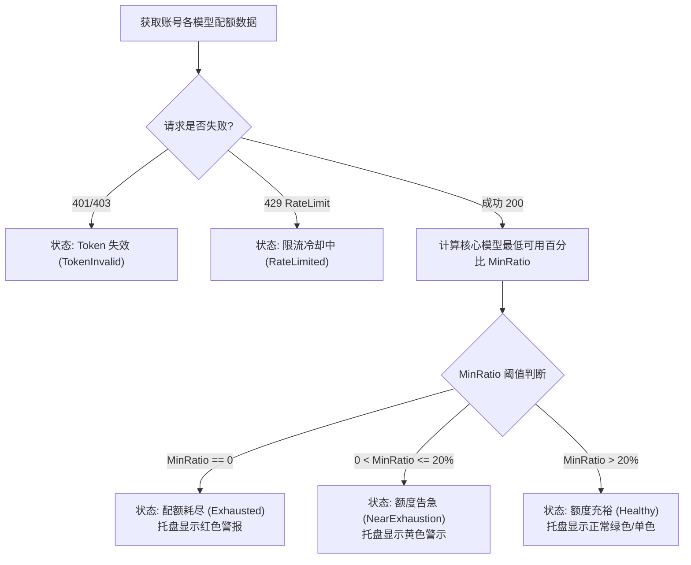

# 配额与额度监控模块 (Quota Module)

## 1. 模块功能

配额模块负责与 Antigravity / Gemini Quota 端点通信，精准获取和监控各账号的模型可用额度与速率限制，主要包括：

- **模型分桶额度查询**：解析 Gemini 2.5 Pro、Gemini 2.5 Flash 以及 Claude 系列模型的专用配额桶（Quota Buckets）。
- **重置倒计时与剩余百分比计算**：计算各模型剩余可用百分比、每日配额重置时间（Reset Time）或滑动窗口速率限制恢复时间。
- **后台低频巡检调度**：以可配置的周期（默认 15~30 分钟）静默轮询所有账号配额，更新本地缓存，无需每次打开界面都阻塞等待网络请求。
- **健康度与风险评估**：根据模型剩余比例计算账号健康评级（良好、低额度预警、完全耗尽、请求限流）。
- **托盘状态聚合指标**：向系统托盘提供当前生效账号的最低核心模型百分比，驱动托盘图标颜色与气泡提示（Tooltip）变化。

---

## 2. 实现逻辑与算法

### 2.1 配额请求与响应解析
- **请求端点**：调用 Antigravity Quota API 接口，携带有效 `Bearer {access_token}`。
- **防风控与节流策略**：
  - 各账号请求之间加入随机 1~3 秒轻量抖动（Jitter），防止同时发起突发并发请求。
  - 遇到 `429 Too Many Requests` 时，记录冷却重置时间（Retry-After），并挂起该账号的后台轮询直到冷却结束。
  - 遇到 `401 Unauthorized` 时，自动尝试触发一次 OAuth Token 刷新，若刷新仍失败则标记凭据失效。

### 2.2 状态判定算法



---

## 3. 详细设计 (Design)

### 3.1 核心数据结构

```go
package quota

import "time"

// ModelQuota 单个模型的配额明细
type ModelQuota struct {
	ModelName      string    `json:"model_name"`       // 模型标识，如 "gemini-2.5-pro"
	DisplayName    string    `json:"display_name"`     // 展示名，如 "Gemini 2.5 Pro"
	Limit          int64     `json:"limit"`            // 配额上限（请求数或 Token 数）
	Remaining      int64     `json:"remaining"`        // 剩余额度
	UsageRatio     float64   `json:"usage_ratio"`      // 使用比例 (0.0 ~ 1.0)
	RemainingRatio float64   `json:"remaining_ratio"`  // 剩余比例 (0.0 ~ 1.0)
	ResetAt        time.Time `json:"reset_at"`         // 配额重置时间
}

// QuotaData 账号整体配额快照
type QuotaData struct {
	AccountID   string                `json:"account_id"`
	Models      map[string]ModelQuota `json:"models"`      // 模型分桶列表
	LowestRatio float64               `json:"lowest_ratio"`// 所有关键模型中最低剩余比
	IsExhausted bool                  `json:"is_exhausted"`// 是否存在关键模型归零
	RefreshedAt time.Time             `json:"refreshed_at"`// 本次快照刷新时间戳
}

// QuotaClient 配额客户端接口
type Client interface {
	FetchQuota(ctx context.Context, accessToken string) (*QuotaData, error)
}

// Inspector 配额后台巡检器
type Inspector interface {
	Start(ctx context.Context, interval time.Duration)
	RefreshNow(ctx context.Context, accountID string) (*QuotaData, error)
	RefreshAll(ctx context.Context) error
}
```

### 3.2 离线优雅降级
当网络中断或离线时，配额模块不会清空已有数据，而是返回持久化在 `accounts.json` 中的上一版本快照，并在 UI 上标注离线时间（如“30 分钟前更新·离线”），保障无网状态下的顺畅操作体验。
