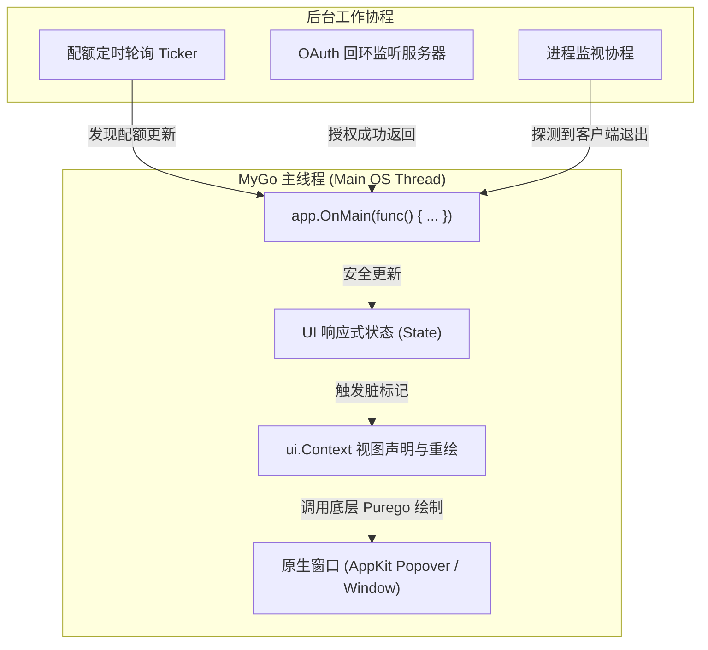

# 原生桌面 UI 与托盘模块 (UI & Tray Module)

## 1. 模块功能

UI 模块基于 **MyGo 原生声明式 UI**（`github.com/egoist/mygo/ui`）构建，专注于提供极致轻量、启动迅速（<100ms）且深度贴合 macOS 原生质感的系统托盘常驻应用，主要功能包括：

- **系统托盘 (System Tray) 常驻与快捷菜单**：
  - 动态托盘图标与状态徽标（正常绿色、低额度黄色、耗尽红色、离线灰色）。
  - 右键直接呼出快捷上下文菜单（快速切换已缓存账号、立即刷新额度、关于、退出）。
  - 左键点击托盘图标弹出居中对齐的原生 Flyout 管理面板（点击外部或按 Esc 自动收起）。
- **主管理面板 (Flyout Window)**：
  - **环境目标选择器**：顶部常驻选择当前生效目标（Antigravity IDE / Antigravity Classic / agy CLI）。
  - **当前活跃账号卡片 (Active Account Card)**：高亮展示当前注入客户端的账号、用户头像、邮箱、核心模型（Gemini 2.5 Pro、Flash、Claude）配额进度条与重置倒计时。
  - **多账号列表与一键切换**：展示所有纳管账号及其健康状态，支持一键点击切换生效账号（带二次确认与加载动效）。
  - **添加账号引导流程**：一键拉起 Google OAuth 浏览器授权流程，界面展示等待状态并自动捕获成功回调。
  - **本地交互设计稿**：已通过 HTML/CSS 绘制高保真交互设计原型，详见 [mockup.html](mockup.html)。

---

## 2. 实现逻辑与主线程调度

### 2.1 MyGo 主线程架构纪律
MyGo 原生 UI 的视图渲染与组件树构建全部运行在操作系统的主事件循环（Main OS Thread）上：

### 2.2 界面组件树划分
- `internal/ui/tray.go`：管理 `mygo.Tray` 实例、图标资源注入、托盘点击坐标计算与菜单。
- `internal/ui/window.go`：管理 Flyout 弹出窗口的尺寸（默认宽 380px，高 560px）、macOS Vibrancy 毛玻璃材质背景及焦点失焦自动关闭逻辑。
- `internal/ui/account_card.go`：封装单个账号渲染单元（活跃状态指示灯、头像缩写、邮箱标签、切换按钮）。
- `internal/ui/quota_view.go`：封装模型配额条形图（ProgressBar）与重置时间渲染。

---

## 3. 设计稿审查入口

为了在编码前对产品视觉形态、交互流转和信息层级进行直观审核，UI 模块提供了高保真交互设计稿：

👉 **[点击在浏览器中打开 UI 交互设计稿原型 (docs/product/ui/mockup.html)](mockup.html)**

> **设计稿包含的交互验证项**：
> 1. **托盘与弹窗形态**：仿真 macOS 顶部状态栏及下方带尖角的 Popover 弹窗。
> 2. **暗色 / 亮色主题切换**：支持右上角切换查看两种系统外观下的质感与对比度。
> 3. **账号即时切换**：点击非活跃账号的「切换」按钮，可模拟体验无缝切换到新账号并刷新卡片的完整交互动效。
> 4. **添加账号弹窗**：点击「+ 添加账号」唤出 Google OAuth 交互弹窗模拟。
> 5. **配额健康预警**：直观展示健康（>20%）、告警（<20%）及耗尽（0%）三种视觉状态。
